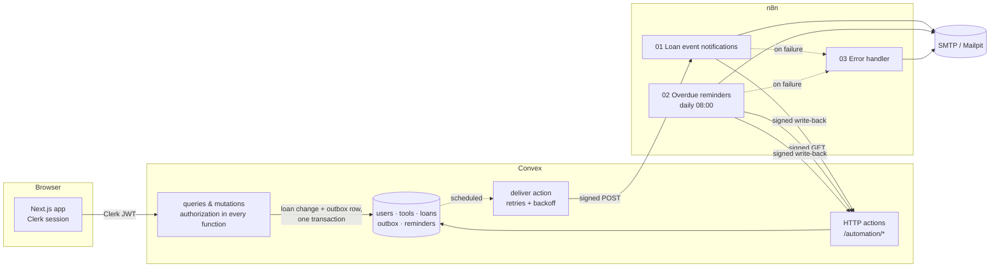
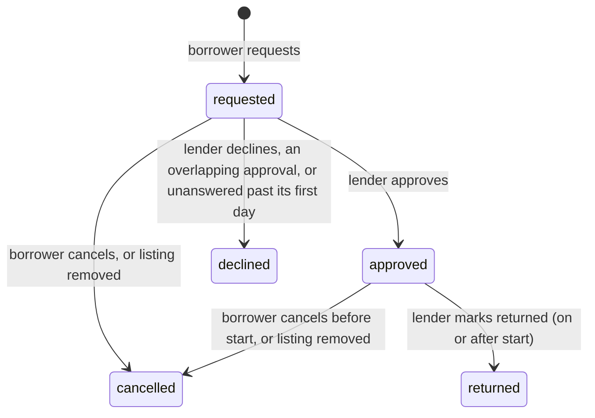

# LendLoop

**Borrow what you need. Lend what you don't.**

LendLoop is a neighbourhood tool-lending board:

- Neighbours list tools they are willing to lend.
- Others ask to borrow them for a date range.
- Lenders approve or decline, then confirm the return.
- n8n sends the request notifications and the daily overdue reminders.

**Stack:** Next.js 16 (App Router), Clerk, Convex, n8n, TypeScript, Tailwind CSS.

This is a take-home assignment for Fluence. [How it was built](#how-this-was-built) covers the use of AI.

## Contents

1. [Requirements map](#requirements-map)
2. [Local setup](#local-setup)
3. [Walkthrough: verify the whole flow](#walkthrough-verify-the-whole-flow)
4. [Environment variables](#environment-variables)
5. [Architecture](#architecture)
6. [Data model](#data-model)
7. [Authentication and authorization](#authentication-and-authorization)
8. [Borrowing lifecycle](#borrowing-lifecycle)
9. [n8n integration](#n8n-integration)
10. [Data minimisation](#data-minimisation)
11. [Testing](#testing)
12. [Production considerations](#production-considerations)
13. [How this was built](#how-this-was-built)

## Requirements map

| Requirement | Implementation |
| --- | --- |
| Public page with tagline, available tools (name and category only) and "Sign in to lend or borrow" | `src/app/page.tsx`. `tools.listPublic` returns only `id`, `name` and `category`. |
| List a tool (name, category, condition, description) | My listings: `tools.create`, `tools.update` |
| Request a tool for a date range | All tools → Request to borrow: `loans.request` |
| Approve or decline requests on your own tools; mark returned | Incoming requests: `loans.approve`, `loans.decline`, `loans.markReturned` |
| All tools with availability, filterable by category | All tools: `tools.list` |
| My listings, My requests, Incoming requests | Dashboard tabs in `src/components/dashboard/` |
| Admin: remove any listing, view all loans, mark a Trusted Lender | `tools.remove`, `admin.allLoans`, `admin.setTrustedLender` |
| Users act only on their own listings and loans, enforced in Convex | The `can.*` rules in `convex/lib/auth.ts`, called inside every function |
| n8n request notification on creation and every status change, minimal fields | Outbox → [workflow 01](n8n/workflows/01-loan-event-notifications.json) |
| n8n daily overdue reminders from a Convex HTTP endpoint, with status written back | [Workflow 02](n8n/workflows/02-overdue-reminders.json). Endpoints: `GET /automation/overdue-loans`, `POST /automation/events`. |
| HMAC signatures verified by the receiver, in both directions | `convex/lib/signing.ts` and the "Verify signature" node |
| Secrets only in environment variables and n8n credentials | `.env*.example`. `n8n/setup/bootstrap.sh` builds the SMTP credential from env. |
| Idempotent write-backs | `notifications.recordResult` and `reminders.recordReminder`, plus n8n dedupe |
| Retries and an error workflow, no silent failures | Convex retries with backoff and two watchdog crons; n8n node retries and [workflow 03](n8n/workflows/03-error-handler.json); Admin → Automation health |
| Bonus: recent automation activity on each loan | e.g. "Approval email to the borrower sent · 5 min ago" |
| docker-compose, README, production note | `docker-compose.yml`, this file |

## Local setup

**You need:**

- Node.js 22 (see `.nvmrc`);
- Docker with Compose v2;
- a free [Clerk](https://clerk.com) account.

Convex runs as a local backend and needs no account.

### 1. Install

```bash
npm ci
cp .env.example .env.local
cp .env.n8n.example .env.n8n
```

### 2. Clerk

1. In the [Clerk dashboard](https://dashboard.clerk.com), create an application with email sign-in.
2. Copy the **Publishable key** and **Secret key** into `.env.local`.
3. Activate the Convex integration (**Integrations → Convex**). Clerk then issues tokens with the `convex` audience that Convex verifies.
4. Add the user's name and email to the session token (**Configure → Sessions → Customize session token**):
   ```json
   { "name": "{{user.full_name}}", "email": "{{user.primary_email_address}}" }
   ```
   LendLoop reads both from the verified token: the name for display, the email for notifications. Without an email, notifications are recorded as failed ("recipient has no email address").
5. Copy the **Frontend API URL** (for example `https://<slug>.clerk.accounts.dev`). It is used in step 3.

### 3. Convex

Start a local Convex backend. It listens on ports 3210 and 3211, writes its URLs to `.env.local` and keeps watching for changes.

```bash
CONVEX_AGENT_MODE=anonymous npx convex dev
```

- `CONVEX_AGENT_MODE=anonymous` skips the login prompt. Without it, choose "Start without an account".
- If you are logged in to Convex, use `npx convex dev --configure new --dev-deployment local` instead.

The first push stops with *"CLERK_JWT_ISSUER_DOMAIN is used in auth config file but its value was not set"*. This is expected. Leave it running and, in a second terminal, set the deployment's variables. `convex dev` picks them up and finishes the push.

```bash
openssl rand -hex 32   # run twice: one secret per direction

npx convex env set CLERK_JWT_ISSUER_DOMAIN https://<slug>.clerk.accounts.dev
npx convex env set LENDLOOP_TO_N8N_SECRET <secret-1>
npx convex env set N8N_TO_LENDLOOP_SECRET <secret-2>
npx convex env set N8N_LOAN_EVENTS_WEBHOOK_URL http://localhost:5678/webhook/lendloop-loan-events
npx convex env set APP_URL http://localhost:3000
```

<details>
<summary>Using a cloud Convex deployment instead</summary>

Convex's servers can't reach `localhost:5678`, so the n8n webhook needs a public URL. Expose **only the webhook path**, and only after you have created the n8n owner account. A plain `cloudflared tunnel --url` publishes the whole editor. An ingress rule like this one exposes the webhook alone:

```yaml
ingress:
  - hostname: lendloop-hooks.example.com
    path: ^/webhook/lendloop-loan-events$
    service: http://localhost:5678
  - service: http_status:404
```

Set `N8N_LOAN_EVENTS_WEBHOOK_URL` to the public URL, and `LENDLOOP_CONVEX_SITE_URL` in `.env.n8n` to `https://<deployment>.convex.site`.
</details>

### 4. n8n and Mailpit

Fill in `.env.n8n`:

| Variable | Value |
| --- | --- |
| `N8N_ENCRYPTION_KEY` | `openssl rand -hex 32` |
| `LENDLOOP_TO_N8N_SECRET`, `N8N_TO_LENDLOOP_SECRET` | the same two values you set in Convex |
| `LENDLOOP_CONVEX_SITE_URL` | keep `http://host.docker.internal:3211` for the local backend |

The other values default to the bundled Mailpit SMTP sink. Then run:

```bash
docker compose up -d
./n8n/setup.sh
```

`setup.sh` is safe to run again. It:

1. waits for n8n's first-start database migration;
2. creates the "LendLoop SMTP" credential from `.env.n8n`;
3. imports the three workflows from `n8n/workflows/` and publishes them;
4. restarts n8n.

You don't need to import anything by hand.

| Service | URL |
| --- | --- |
| Mailpit inbox (every email lands here) | <http://localhost:8025> |
| n8n editor (the first visit creates a local owner account; the workflows run without it) | <http://localhost:5678> |

### 5. Start the app

```bash
npm run dev   # http://localhost:3000
```

### 6. Make yourself admin

Roles live in Convex. No client can change them: `admin:setRole` is an internal function, callable only with deployment access (the CLI).

Sign in to the app once so your user row exists, then run:

```bash
npx convex run admin:setRole '{"email":"you@example.com","role":"admin"}'
```

Reload the dashboard and the **Admin** tab appears.

## Walkthrough: verify the whole flow

You need two accounts. Use a normal window for the lender and a private window for the borrower. Every email appears in Mailpit.

1. **List a tool.** As the lender, open **My listings → List a tool**.
2. **Request it.** As the borrower, open **All tools → Request to borrow** and pick dates. Mailpit receives "wants to borrow" for the lender, and the loan card shows "Request email to the lender sent".
3. **Approve it.** As the lender, open **Incoming requests → Approve**.
   - Both sides see *Approved* and each other's email for the handover.
   - Mailpit receives the approval email for the borrower.
   - Declining instead sends a decline email.
4. **Send an overdue reminder.** Make the loan overdue with the dev-only helper, then run the reminder workflow. You can also click **Execute workflow** on "LendLoop - Overdue reminders" in the n8n editor.

   ```bash
   npx convex data loans                      # copy the approved loan's _id
   npx convex env set ALLOW_DEV_SEED true
   npx convex run devtools:makeLoanOverdue '{"loanId":"<loan id>","daysOverdue":2}'
   docker compose exec -e N8N_RUNNERS_BROKER_PORT=5699 -e N8N_PORT=5690 n8n n8n execute --id lendloopOverdue1
   ```

   - The borrower gets a reminder, and the loan shows "Overdue reminder sent".
   - Running the workflow again the same day sends nothing.
   - The two port variables stop the one-off run from clashing with the running n8n.
5. **Return it.** As the lender, choose **Mark as returned**. The borrower gets a confirmation, and the tool is available again.
6. **Optional failure test.**
   1. Run `docker compose stop mailpit` and make another request.
   2. n8n's email retries fail, and the result is written back as `failed`.
   3. It appears under **Admin → Automation health**.
   4. Run `docker compose start mailpit` and click **Resend**.

### Troubleshooting

- **The Convex logs show "timestamp outside allowed window", and n8n gets `401`.**
  - The cause: the Docker VM's clock and the host's clock differ by more than the 5-minute replay window. Docker Desktop's clock can drift after the machine sleeps.
  - The fix: during testing it resynced on its own within minutes. If it persists, restart Docker Desktop.
  - Don't widen the window; it is part of the replay protection.
- **"Environment variables have changed during push" while you set variables in step 3.** This is harmless: `convex dev` retries and then prints "Convex functions ready!".
- **Ports.** The stack needs ports 3000, 3210, 3211, 5678, 8025 and 1025 to be free.

## Environment variables

| Where | Variable | Purpose |
| --- | --- | --- |
| `.env.local` (Next.js) | `NEXT_PUBLIC_CLERK_PUBLISHABLE_KEY`, `CLERK_SECRET_KEY` | Clerk keys |
| | `NEXT_PUBLIC_CONVEX_URL` | Convex client URL (written by `convex dev`) |
| | `CONVEX_DEPLOYMENT`, `NEXT_PUBLIC_CONVEX_SITE_URL` | Written by `convex dev`; used by the CLI, not the app |
| Convex deployment (`npx convex env set`) | `CLERK_JWT_ISSUER_DOMAIN` | Clerk issuer that Convex trusts |
| | `N8N_LOAN_EVENTS_WEBHOOK_URL` | n8n webhook for loan events |
| | `LENDLOOP_TO_N8N_SECRET` | Signs Convex → n8n requests |
| | `N8N_TO_LENDLOOP_SECRET` | Verifies n8n → Convex requests |
| | `APP_URL` | Base URL for links in emails |
| | `ALLOW_DEV_SEED` | `true` enables `devtools:*` (local only) |
| `.env.n8n` (Docker) | `N8N_ENCRYPTION_KEY` | Encrypts n8n's credential store |
| | `LENDLOOP_TO_N8N_SECRET`, `N8N_TO_LENDLOOP_SECRET` | The same two secrets, from the other side |
| | `LENDLOOP_CONVEX_SITE_URL` | Convex HTTP actions URL |
| | `LENDLOOP_APP_URL`, `LENDLOOP_MAIL_FROM`, `LENDLOOP_OPS_EMAIL` | Email links, sender, failure alerts |
| | `LENDLOOP_SMTP_*` | SMTP settings for the generated credential (Mailpit by default) |

Secrets live only in git-ignored files, Convex environment variables and the n8n credential store. The repository and the exported workflows contain none: the workflows reference one SMTP credential by id, and read the HMAC secrets through `$env`.

## Architecture



**Technology decisions**

- **Convex is the only backend.** Its functions are the API, so every rule is enforced where the data lives. Reactive queries keep both parties' dashboards in sync without polling. The scheduler and crons run the notification outbox.
- **Clerk handles identity.** Convex verifies the Clerk JWT on every call. The user's profile comes from the verified token, never from function arguments.
- **n8n owns delivery, not state.** It composes and sends emails and runs the daily schedule. Convex stays the source of truth, and n8n reports results back.
- **Transactional outbox.** A mutation never calls the webhook directly. It writes an outbox row in the same transaction as the loan change, so a notification exists if and only if the change commits.
- **Next.js App Router.** `src/proxy.ts` sends signed-out visitors from `/dashboard` to sign-in. The public page renders the live catalogue from a public Convex query.
- **Dates are whole UTC calendar days** (`YYYY-MM-DD`), so string order is time order, and the rules stay simple for one neighbourhood.

**Code map**

| Path | Contents |
| --- | --- |
| `convex/schema.ts` | Tables and indexes |
| `convex/lib/constants.ts` | Every enum and limit, with validators derived from the same arrays |
| `convex/lib/auth.ts` | `requireViewer`, `requireAdmin` and the `can` object: every ownership rule in one place |
| `convex/lib/signing.ts` | HMAC signing and verification, shared by both directions |
| `convex/tools.ts`, `convex/loans.ts` | Catalogue, listings and the loan lifecycle |
| `convex/lib/loans.ts`, `convex/lib/tools.ts` | Date rules, availability, loan activity |
| `convex/lib/outbox.ts`, `convex/notifications.ts` | Outbox rows, delivery to n8n, results written back |
| `convex/http.ts`, `convex/reminders.ts` | The two endpoints n8n calls; the overdue list and reminder write-backs |
| `convex/admin.ts` | All loans, members, Trusted Lender, automation health and Resend, `setRole` |
| `convex/crons.ts` | Stuck-delivery sweep, unconfirmed check, expiry of unanswered requests |
| `src/components/dashboard/` | Dashboard tabs and shared loan components |
| `n8n/workflows/`, `n8n/setup.sh` | Exported workflows and the one-command import |
| `tests/` | `convex-test` suites and the n8n signing contract test |

## Data model

| Table | Purpose | Key fields | Indexes |
| --- | --- | --- | --- |
| `users` | One row per Clerk user | `tokenIdentifier`, `name`, `email`, `role` (`user`/`admin`), `trustedLender` | `by_tokenIdentifier`, `by_email` |
| `tools` | Listings, soft-deleted so loan history keeps a real row | `ownerId`, `name`, `category`, `condition`, `description`, `removedAt`, `removedBy` | `by_ownerId`, `by_ownerId_and_removedAt`, `by_removedAt`, `by_removedAt_and_category` |
| `loans` | A request and, once approved, the loan itself | `toolId`, `ownerId`, `borrowerId`, `startDate`, `endDate` (inclusive), `message`, `status`, `decidedAt`, `returnedAt` | by tool and status, by borrower, by owner, by status with start or end date |
| `outbox` | One row per notification, from enqueue to the email result | `type`, `loanId`, `recipientId`, `status`, `attempts`, `nextAttemptAt`, `lastError`, `deliveredAt`, `resultAt` | `by_status_and_nextAttemptAt`, `by_status_and_deliveredAt`, `by_loanId` |
| `reminders` | Overdue reminder results, one per loan per day | `reminderKey` (`overdue:<loanId>:<date>`), `loanId`, `status`, `detail`, `occurredAt` | `by_reminderKey`, `by_loanId`, `by_status_and_occurredAt` |

Every read goes through an index and is bounded with `.take(n)` or a bounded iteration. There are no unbounded `.collect()` calls.

## Authentication and authorization

- **Sign-in.** Clerk handles sign-in.
- **Verification.** Convex validates the token's issuer (`CLERK_JWT_ISSUER_DOMAIN`) and audience (`convex`).
- **User row.** On first sign-in, `users.ensureCurrentUser` creates the user row from the verified token's claims. The display name is sanitised because it appears in other people's emails: only letters, spaces, hyphens, apostrophes and periods, and no link-like words.

Every Convex function checks access itself before reading or writing. The UI hides buttons only for convenience.

| Action | Anonymous | User | Admin |
| --- | --- | --- | --- |
| See available tools (name, category) | ✓ | ✓ | ✓ |
| See all tools with status, lender's first name, Trusted badge | | ✓ | ✓ |
| List a tool / edit a listing | | own only | own only |
| Remove a listing | | own, not while lent out | any |
| Request to borrow | | others' tools | others' tools |
| Approve, decline, mark returned | | as lender | as lender |
| Cancel | | as borrower | as borrower |
| See loans | | own (borrower or lender) | all |
| Mark a Trusted Lender | | | ✓ |
| Grant the admin role | | | CLI only (internal `admin:setRole`) |

- **Roles.** Roles are stored in Convex, never taken from client input or token claims.
- **Errors.** Errors are `ConvexError({ code, message })` with the codes `UNAUTHENTICATED`, `FORBIDDEN`, `NOT_FOUND`, `CONFLICT`, `INVALID` and `RATE_LIMITED`. No internals reach the client.
- **Tests.** `tests/access-control.test.ts` calls the functions directly, as a hostile client would.

## Borrowing lifecycle



**Approval**

- A request can be approved up to and including its first day, and only for days that are free.
- Approving auto-declines other open requests that overlap, and each of those borrowers is told.
- An hourly cron closes requests still unanswered after their first day, and emails the borrower (`loan.expired`).

**Dates**

- A loan is at most 30 days long and starts at most 90 days ahead. The date pickers apply the same limits.

**Overdue**

- A loan is overdue when it is approved and its end date has passed.
- An overdue tool can't be booked or approved for any later days until the lender marks it returned.

**Handover**

- While a loan is approved, the lender and the borrower see each other's email.

**Limits**

- A borrower can send at most 10 requests an hour and keep at most 2 open requests per tool.
- An account can have at most 50 live listings and add at most 20 an hour.
- The limits count real rows inside the mutation, so they are exact.

**Removing a listing**

- The listing is soft-deleted. Its open requests and upcoming bookings are closed, in batches of 50, and each borrower is notified.

## n8n integration

| Workflow | Trigger | Does |
| --- | --- | --- |
| 01 Loan event notifications | Signed webhook from Convex | Verifies the signature, drops duplicate events, emails the recipient, writes the result back |
| 02 Overdue reminders | Daily at 08:00 Europe/Sarajevo (plus a manual trigger) | Fetches overdue loans from Convex, emails each borrower, writes each result back |
| 03 Error handler | Any failed execution of 01 or 02 | Emails `LENDLOOP_OPS_EMAIL` with the workflow, node, error and execution link |

Events sent to n8n: requested, approved, declined, cancelled, listing removed, returned and expired.

### Delivery from Convex to n8n

1. **Write.** The mutation writes the outbox row (`pending`) and schedules `notifications.deliver`.
2. **Deliver.** `deliver` builds a minimal payload, signs it and POSTs it with a 10-second timeout. When n8n answers `202` the row becomes `delivered`, and n8n owns the email from there.
3. **Report back.** n8n writes the email result back onto the same row, which becomes `sent` or `failed`.

### HMAC verification

The same scheme is used in both directions, with a separate secret per direction, so a leak on one side doesn't compromise the other.

```
X-LendLoop-Timestamp: <unix seconds>
X-LendLoop-Signature: sha256=HMAC_SHA256(secret, "<timestamp>.<METHOD>.<path>.<raw body>")
```

- **What is signed.** Both sides sign and verify the raw body bytes, never re-serialised JSON.
- **Comparison.** The signature is compared in constant time.
- **Rejection.** Any failure returns a generic `401`; the reason is only logged.
- **Contract test.** `tests/n8n-signing.test.ts` runs the n8n Code nodes' JavaScript, exactly as exported, against `convex/lib/signing.ts`. If either side changes the canonical string, the test fails.

### Replay protection

- **Freshness.** A timestamp more than 300 seconds from the receiver's clock is rejected.
- **Binding.** The method and path are signed, so a captured request can't be replayed against another endpoint.
- **Inside the window.** Replays are harmless: n8n drops events it has already handled (dedupe on the event id), and Convex write-backs are idempotent.

### Idempotency

| Key | Record | Behaviour |
| --- | --- | --- |
| `notify:<outboxId>` | That notification's outbox row | First result: `created`. Same result again: `duplicate`, nothing changes. `failed` then `sent`: `updated`. |
| `overdue:<loanId>:<date>` | That loan's reminder for that day | Same rules. Convex also leaves loans already reminded today out of the overdue list, and n8n dedupes on the key, so a second run the same day sends nothing. |

**Guards on write-backs**

- A key must carry its kind's prefix and name its own loan.
- A reminder key must be today's or yesterday's, for a loan that was overdue on that day.
- Timestamps in the future are clamped.
- Unknown records get `404`.
- Bodies are capped at 8 KB (`413`).

### Retries and failure handling

**In Convex**

- **Retries.** A failed delivery is retried after 30 s, 2 min, 10 min, 1 h and 6 h. After 6 attempts the row becomes `failed`.
- **Missing data.** An event whose loan, tool or recipient is gone fails at once, because a retry can't help.
- **Stuck deliveries.** A cron re-schedules any delivery more than 5 minutes overdue, which covers a crashed action. It runs every 5 minutes, and lost attempts count toward the limit.
- **Unconfirmed results.** A second cron, also every 5 minutes, flags `delivered` rows with no result after 15 minutes as `unconfirmed`. This covers n8n crashing after it answered `202`.
- **Admin panel.** **Admin → Automation health** lists failed and unconfirmed notifications, deliveries waiting to retry with their last error, and failed reminders.
- **Resend.** **Resend** enqueues a new event with a new id and marks the old row `resent`. It first checks the notice still matches the loan: a request notice for a request that was since cancelled is dismissed instead of sent.

**In n8n**

- **Node retries.** The HTTP and email nodes retry.
- **Email failures.** A failed email takes the error output and is written back as `failed` with the SMTP error.
- **Error workflow.** Any unhandled error triggers workflow 03.
- **Execution history.** Failed executions stay in the execution list for 7 days, so they are visible even if SMTP is down.

## Data minimisation

| Who | Sees |
| --- | --- |
| Anonymous visitors | Available tools' names, categories and opaque ids; nothing about owners |
| Signed-in neighbours | Lenders' first names and Trusted badges. The request message is visible only to the borrower and the lender. |
| The two people on an approved loan | Each other's email, only while the loan is approved |
| Admins | Members' emails, in the member list |
| n8n, loan events | Recipient's first name and email; the other person's first name; tool name; dates; event id, type and time; loan id; app URL |
| n8n, overdue list | Borrower's first name and email, tool name, due date, days overdue |
| n8n execution history | Only failed and manual runs are saved, and they are pruned after 7 days |
| Error alerts | Workflow, node, error message and execution link; no user data |

Docker publishes n8n and Mailpit on `127.0.0.1` only.

## Testing

```bash
npm test            # Vitest + convex-test: 51 tests
npm run lint
npm run typecheck   # next typegen && tsc --noEmit
npm run build
```

**Unit and integration tests** (`tests/`):

- **Access control.** Every rule in the table above, called as a hostile client. Contact details and request messages are visible only to the parties involved.
- **Booking rules.** Date rules and booking clashes, including an overdue tool blocking later bookings.
- **Expiry and limits.** Expiry of unanswered requests; request and listing limits.
- **Text sanitising.** Display names, links in tool names, line breaks in descriptions.
- **Signatures.** Valid, tampered body, wrong path, wrong secret and stale timestamp. Unsigned endpoint calls are rejected.
- **Delivery.** Signed and posted once on `202`; retried with backoff on HTTP 500, then failed; a delivery that keeps getting lost ends as `failed`; an event with missing data fails immediately.
- **Write-backs.** Idempotency, a result naming another loan, reminder keys for the wrong day or a non-overdue loan.
- **Admin repair.** Unconfirmed and failed notifications, Resend, and stale-notice dismissal.
- **Contract test.** The n8n signing contract.

**End-to-end and browser QA** used:

- the real stack (Clerk development instance, local Convex, n8n in Docker, Mailpit);
- real Chrome for signed-in flows and Playwright for anonymous checks;
- direct Convex calls as other users to prove server-side enforcement.

The results, including what was not tested, are in [BROWSER_QA_REPORT.md](BROWSER_QA_REPORT.md). [FINAL_SUMMARY.md](FINAL_SUMMARY.md) maps each requirement to its evidence.

## Production considerations

**Hosting**

- **Deployments.** `npx convex deploy` to a production deployment, a Clerk production instance, and separate secrets per environment.
- **n8n placement.** n8n behind HTTPS, with the webhook path as its only public route, ideally IP-allowlisted.
- **n8n scaling.** Queue mode (Postgres, Redis, external runners) instead of one SQLite container.

**Secrets**

- **Environment access.** Keep `N8N_BLOCK_ENV_ACCESS_IN_NODE=true` and supply the HMAC secrets through n8n external secrets.
  - Locally the workflows read them with `$env`, which means anyone who can edit workflows can read the container's environment.
- **Rotation.** Rotate secrets with two active keys per direction and a key id in the header.

**Replay and signing**

- **Request ids.** Add a request id to the signature, and remember ids for the 5-minute window.
- **Signed path.** Sign a fixed logical path, so a reverse proxy that changes the path can't break verification.

**Email and alerting**

- **Email provider.** A real provider (Postmark or SES) with SPF, DKIM and DMARC, bounce handling, notification preferences and an opt-out.
- **Alerting.** Push failed and unconfirmed deliveries to Slack or PagerDuty from the existing crons. Give the n8n error workflow a channel other than the SMTP server it may be reporting on.
- **Reminder retries.** Record a reminder key in n8n's dedupe only after a successful send, so a failed reminder can be retried the same day.

**Scale and time**

- **Pagination.** Paginate the catalogue and loan lists. Today they are bounded at a few hundred rows.
- **Rate limits.** Move to `@convex-dev/rate-limiter` if limits need to be configurable.
- **Time zones.** Store a time zone per neighbourhood instead of using UTC days.

**Data lifecycle**

- **Retention.** Delete or anonymise old outbox and reminder rows.
- **Account deletion.** Handle Clerk's `user.deleted` webhook.
- **Roles.** Grant roles by user id, and store only verified emails.
- **Admin trail.** Keep an audit log of admin actions, and notify owners when an admin removes their listing.

**Delivery pipeline**

- **CI.** Run tests, lint, typecheck and build in CI.
- **Browser tests.** Add Playwright end-to-end tests against a Clerk test instance.
- **Credential check.** Check that the exported workflows stay free of credentials.

## How this was built

I built LendLoop with Claude Code (Anthropic's AI coding assistant) as a pair programmer. It handled:

- implementation;
- code-quality and security reviews, using the checklist in `.claude/skills/lendloop-security-review`;
- the browser QA recorded in [BROWSER_QA_REPORT.md](BROWSER_QA_REPORT.md).

The design decisions, trade-offs and test evidence are documented above so they can be checked independently.

No open-source licence is granted. The code is shared for evaluation as part of the Fluence take-home.
